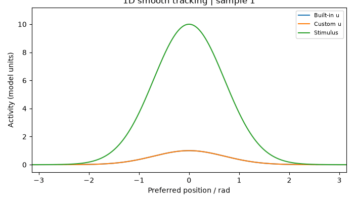
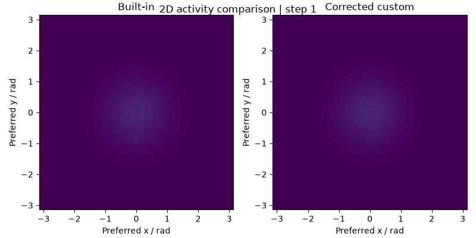

# Continuous attractor networks

My neural-computation coursework exploring **1D ring and 2D periodic-sheet CANNs** with BrainPy and CANNs. It compares built-in models with corrected custom reference implementations and includes supplied optional experiments on noisy input and two-bump evolution.

## What the project demonstrates

- Periodic distance functions and Gaussian connection matrices.
- Divisive firing-rate normalisation and Euler updates.
- Moving-stimulus tracking on a ring and periodic sheet.
- Numerical comparison between built-in and custom implementations.
- Illustrative noisy-template and free-evolution experiments.

The source mixes filled-in work, incomplete exercises and provided answer keys. Reference-answer adaptations and preparation changes are documented; supplied teaching material is not presented as wholly independent research.

## Run

Use Python 3.11 or 3.12. From the project folder:

```bash
python3.11 -m venv .venv
source .venv/bin/activate
python -m pip install -r requirements.txt
```

On Windows, activate with `.venv\Scripts\activate`. Open [cann_tracking.ipynb](cann_tracking.ipynb) in VS Code with its Python/Jupyter extensions and select the environment as the kernel.

For Colab, upload the notebook and requirements file, run `%pip install -r requirements.txt` in a separate cell, restart if prompted, then run from the top. No external dataset or GPU is required. The dense 64 x 64 network needs substantial working memory: one float32 connection matrix is 64 MiB, with additional matrices, activity histories and temporary arrays.

## Tracking experiments

The 1D experiment uses 512 neurons, a time step of 0.1, and a 42-unit path with control positions [0,0,pi,2pi]. The two drifting intervals have the same speed. Built-in and custom networks receive matching tasks.



The 2D experiment uses 64 x 64 neurons and the source's 60-unit main trajectory, including the return to (0.75,0.75). It is not mixed with the shorter duplicate answer-key path.



These animations show sampled frames at a convenient playback speed. They are activity visualisations, not a separately calculated energy function. Static views are also available in [the 1D plot](figures/tracking_1d.png) and [2D snapshots](figures/tracking_2d_snapshots.png).

## Optional-answer adaptations

- **Noisy template:** 128 neurons, position zero, 50 model-time units. [Animation](figures/noisy_template.gif) and [static plot](figures/noisy_template.png). Temporal fluctuation statistics are exported; smoother output alone is not proof of general denoising performance.
- **Two initial bumps:** 256 neurons, initial amplitude 0.3 at positions +/-pi/4, 200 model-time units without external input. [Animation](figures/two_bump_evolution.gif) and [static plot](figures/two_bump_evolution.png). The initial amplitude is an exercise choice, not a derived steady-state value.

## Corrections and numerical scope

The learner's custom 1D and 2D kernels put the normalising factor **inside** the Gaussian exponential. This version uses the correct formula supplied in the reference answers, with the factor outside the exponential. The corrected models are compared with the actual CANNs built-ins over the full trajectories.

The source/library's endpoint-inclusive grids and 2D kernel scaling are retained for comparison. They should not be mistaken for an exactly seam-free discrete ring or a unit-normalised 2D probability density. The rate sum is bounded by 1/k; this does not determine the steady membrane-activity amplitude.

A finite simulation with driven activity is not proof of a continuous attractor manifold. Parameter sweeps, multiple noise seeds, time-step convergence and biological validation are not included.

## Results and files

[analysis_summary.json](results/analysis_summary.json) records settings, package versions, comparison errors and activity statistics. The results folder also contains compact sampled activity arrays, final noisy profiles and the two-bump peak trace. Full dense matrices and embedded JavaScript animations are not bundled.

```text
cann_tracking.ipynb        English notebook with executed outputs
requirements.txt          Runtime and notebook dependencies
.gitignore                Local environment/cache exclusions
figures/                  Four PNG plots and four compact GIFs
results/                  Historical summary, new metrics and snapshots
docs/COURSEWORK_NOTES.md   Translated exercise context and attribution
```

## Attribution

I (Judy Wu) completed this as coursework for the workshop: Neural Computational Modeling and Continuous Attractor Networks. See [translated coursework notes](docs/COURSEWORK_NOTES.md). No repository license has been assigned.

Software: [CANNs](https://github.com/sichaohe/canns) and [BrainPy](https://github.com/brainpy/BrainPy). See [coursework context](docs/COURSEWORK_NOTES.md) and [result provenance](results/README.md).
